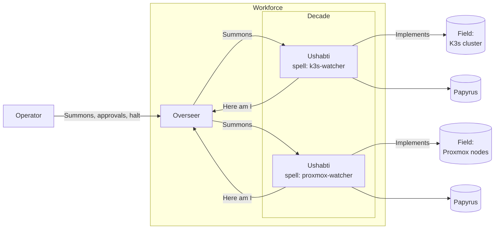
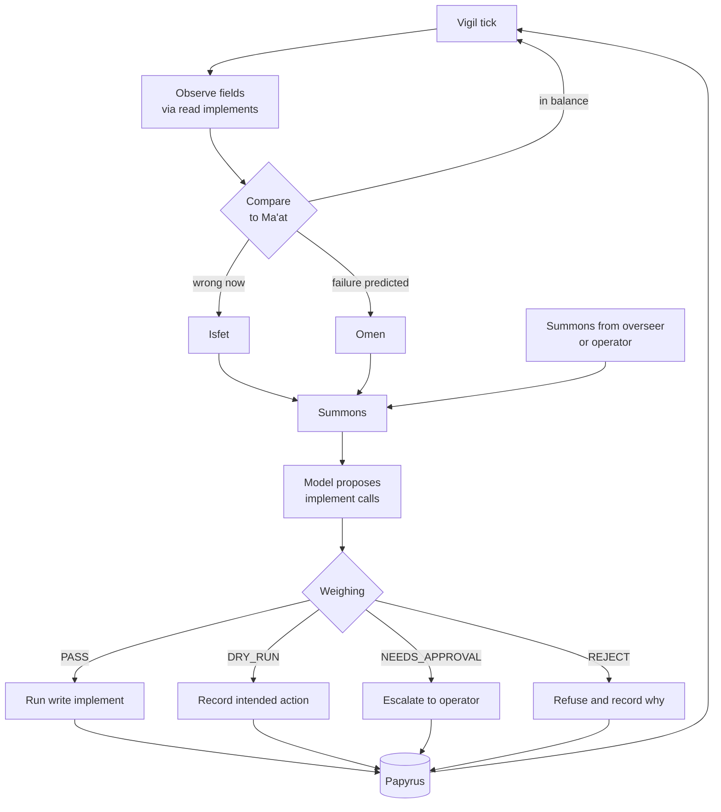

# Ushabti: Scaffolding Instruction for Claude Code

Put this file in an empty directory and run:

```bash
claude "Read SCAFFOLD.md and execute it phase by phase."
```

---

## 0. Rules for executing this document

You are scaffolding **Ushabti**, an open-source DevOps agent harness. Follow these rules throughout:

1. Work through the phases in section 5 in order. Create a task list with one item per phase.
2. At the end of each phase, run that phase's checks. Do not start the next phase until they pass.
3. Commit after each phase using Conventional Commits, for example `chore(scaffold): phase 1 workspace and tooling`.
4. **Stop and ask the user before:**
   - choosing a license (recommend Apache-2.0 for its patent grant, but the user decides);
   - adding a runtime dependency not named in this document;
   - anything that publishes, pushes, or uploads to PyPI, Docker Hub, GHCR, or GitHub. This scaffold never publishes.
5. Do not pin dependency versions from memory. Add dependencies with `uv add` so the current stable versions resolve at scaffold time and `uv.lock` records them. When writing code against a third-party SDK (Anthropic, OpenAI, Kubernetes, Proxmox), look up its current documentation first; do not guess API shapes.
6. This is a scaffold: interfaces, data models, wiring, stubs, and tests. Implement real behaviour only where this document says **Implement fully**. Mark every stub with `# TODO(scaffold):` and make it raise `NotImplementedError` with a message that names what is missing.
7. Use the glossary terms in section 2 exactly, in code identifiers, CLI commands, config keys, and docs.
8. Never write secrets to any file. Secrets come from environment variables or Kubernetes Secrets only.
9. In Mermaid diagrams, use `<br/>` for line breaks inside node labels; never `\n`.

---

## 1. What Ushabti is

Ushabti monitors infrastructure, detects current failures, predicts upcoming ones, and takes guarded corrective actions. It is one tool that runs in three topologies:

| Mode | Meaning |
|---|---|
| `solo` | One ushabti running one spell; no overseer. |
| `independent` | Several ushabti, each configured and deployed separately; no overseer. |
| `overseen` | One or more overseers coordinate decades of ushabti. |

- **First target:** the author's homelab: K3s on Proxmox, with Prometheus metrics.
- **Then:** a general open-source release.
- **Distribution:**
  - the SDK on PyPI as `ushabti`;
  - the agent and overseer as container images and as PyPI packages;
  - the source on GitHub.
- **Models:** provider-agnostic, with adapters for Anthropic and for any OpenAI-compatible endpoint, which covers local servers such as Ollama and vLLM.
- **Language:** Python everywhere.

**Name origin** (for the README): ushabti were ancient Egyptian funerary figurines placed in tombs to do labour on behalf of the deceased. The name is associated with the Egyptian word for "answer," so they were known as "The Answerers." When the deceased was summoned to work, the figurine was to answer "Here am I" and take their place. The most elaborate tombs held 365 workers and 36 overseers, each overseer supervising ten workers. The variant spellings are **shabti** and **shawabti**; the README must mention them so people searching those spellings find the project.

---

## 2. Glossary

This is the project's shared vocabulary. The README links to it, and `docs/glossary.md` is a copy of this section.

| Term | Identifier | Plain meaning | Origin |
|---|---|---|---|
| **Ushabti** | `Ushabti` | One agent instance running one spell. The plural is also "ushabti". | Historical: figurines that worked on behalf of the deceased. |
| **Overseer** | `Overseer` | The optional orchestrator. It registers ushabti, routes summons, and tracks their health. | Historical: overseer figures, each supervising ten workers. |
| **Decade** | `Decade` | A group of ushabti supervised by one overseer. The default size is 10 and is configurable. | The 1:10 ratio is historical; the word "decade" is ours. |
| **Workforce** | `Workforce` | Everything deployed: all overseers and ushabti. | Metaphor. |
| **Spell** | `Spell`, `spell.yaml` | The declarative definition of one ushabti: role, instructions, model, fields, implements, Ma'at, and weighing policy. | Historical: the shabti spell inscribed on the figurines. |
| **Implement** | `Implement` | A tool an ushabti can use. Every implement is either `read` or `write`. | Historical: figurines were carved holding tools such as a hoe, basket, or mattock. |
| **Field** | `Field` | A target an ushabti tends: a K3s cluster, a namespace, a Proxmox node, a service. | Historical: field labour was the figurines' main work. |
| **Summons** | `Summons` | A unit of work. It can come from the vigil, an overseer, or a human operator. | Historical: the figurine answered when the deceased was summoned to work. |
| **Here am I** | `HereAmI` | The heartbeat and acknowledgement message. It is also the body of the health endpoint. | Historical: the figurine's answer. |
| **Vigil** | `Vigil` | The monitoring loop: periodic observation of fields. | Metaphor. |
| **Ma'at** | `Maat` | The desired state: assertions about what healthy looks like. | Egyptian concept of order and balance. |
| **Isfet** | `Isfet` | Current drift from Ma'at: something is wrong now. | Egyptian concept of chaos, the opposite of ma'at. |
| **Omen** | `Omen` | A prediction that Ma'at will be broken soon, such as a disk filling or a certificate nearing expiry. | Metaphor. |
| **Weighing** | `Weighing`, `Verdict` | The safety gate every write implement must pass. Verdicts are `PASS`, `DRY_RUN`, `NEEDS_APPROVAL`, and `REJECT`. | Egyptian: the Weighing of the Heart against the feather of ma'at. |
| **Papyrus** | `Papyrus`, `PapyrusEntry` | The append-only audit log of omens, isfet, summons, verdicts, and actions. | Metaphor. |
| **Halt** | `halt` | The kill switch. A halted ushabti stops acting but keeps observing. | Plain term. |

**Naming rules:**
- Classes use PascalCase (`Ushabti`, `HereAmI`, `Maat`), modules use snake_case (`here_am_i.py`, `maat.py`), and config keys use snake_case.
- Write "Ma'at" in prose and `Maat` or `maat` in code, because identifiers cannot contain apostrophes.
- In docs, the first use of each term on a page includes its plain meaning, for example "a summons (a unit of work)".

The "Historical" origins are supported by the sources in section 7. The Ma'at, Isfet, and Weighing of the Heart origins come from general Egyptology; verify them before the docs are published.

---

## 3. Architecture

Deployed topology in `overseen` mode:



The loop inside one ushabti:



**Safety defaults.** These are non-negotiable in the scaffold:
- `dry_run: true` by default in every spell and in every Helm and Compose example.
- Every write implement passes through Weighing. There is no code path that runs a write implement without a verdict.
- A spell can only use the implements it lists. Anything else gets `REJECT`.
- There is no shell implement in the scaffold.
- Kubernetes RBAC is read-only by default; write verbs require opt-in through `agent.rbac.allowWrite: true`.
- Papyrus is append-only.
- Halt works without the model. It needs no LLM call, and the `ushabti halt` command and the `POST /halt` endpoint both take effect immediately.

---

## 4. Repository layout

The repository is a monorepo managed as a uv workspace.

```
ushabti/
├── pyproject.toml                  # uv workspace root; not published
├── uv.lock
├── README.md
├── LICENSE                         # ask the user (rule 4)
├── CONTRIBUTING.md
├── SECURITY.md
├── CODE_OF_CONDUCT.md              # Contributor Covenant
├── .gitignore
├── .editorconfig
├── .pre-commit-config.yaml
├── docs/
│   ├── glossary.md                 # copy of section 2
│   ├── architecture.md             # section 3 diagrams plus prose
│   ├── safety.md                   # weighing defaults and how to loosen them
│   └── spells.md                   # spell.yaml reference
├── examples/
│   └── spells/
│       ├── k3s-watcher.yaml
│       └── proxmox-watcher.yaml
├── packages/
│   ├── ushabti/                    # SDK; PyPI name `ushabti`; import `ushabti`
│   │   ├── pyproject.toml
│   │   ├── src/ushabti/
│   │   └── tests/
│   ├── ushabti-agent/              # PyPI `ushabti-agent`; import `ushabti_agent`; CLI `ushabti`
│   │   ├── pyproject.toml
│   │   ├── src/ushabti_agent/
│   │   └── tests/
│   └── ushabti-overseer/           # PyPI `ushabti-overseer`; import `ushabti_overseer`; CLI `ushabti-overseer`
│       ├── pyproject.toml
│       ├── src/ushabti_overseer/
│       └── tests/
├── deploy/
│   ├── docker/
│   │   ├── agent.Dockerfile
│   │   └── overseer.Dockerfile
│   ├── compose/
│   │   ├── solo.yaml
│   │   └── overseen.yaml
│   └── helm/
│       └── ushabti/
└── .github/
    ├── dependabot.yml
    └── workflows/
        ├── ci.yaml
        └── release.yaml
```

---

## 5. Phases

### Phase 0: Preflight

1. Confirm the working directory contains only `SCAFFOLD.md`. If it contains anything else, stop and ask.
2. Check that `git`, `uv`, `python3`, `docker`, and `helm` are installed, and report their versions. If any is missing, stop and tell the user; do not install system tools without asking.
3. Run `git init` and set the default branch to `main`.

**Check:** all tools are present and the repository is initialised.

### Phase 1: Workspace and tooling

1. Create the root `pyproject.toml` as a uv workspace with members `packages/*`.
2. Set `requires-python = ">=3.12"` in every package.
3. Create the three package directories with their own `pyproject.toml`, using the names in section 4. Every package starts at version `0.1.0.dev0`. Use the `uv_build` build backend; fall back to `hatchling` only if `uv_build` cannot do something required.
4. Add the following dev tooling to the workspace root, resolved with `uv add --dev`:
   - `ruff`, for linting and formatting;
   - `mypy`, in strict mode;
   - `pytest`, `pytest-asyncio`, and `pytest-cov`;
   - `pre-commit`.
5. Create `.gitignore` (Python, uv, editors, `.env`, Papyrus output files), `.editorconfig`, and `.pre-commit-config.yaml` with ruff and mypy hooks.
6. Ask the user which license to use, then add `LICENSE`.

**Check:** `uv sync --all-packages` succeeds, and `uv run ruff check .` and `uv run mypy packages` both pass.

### Phase 2: SDK (`packages/ushabti`)

**Runtime dependencies:**
- `pydantic` (v2), `pydantic-settings`, `pyyaml`, and `structlog`.
- Optional extras, with their imports guarded so the core installs without them:
  - `anthropic`: the Anthropic SDK;
  - `openai`: the OpenAI SDK, used against OpenAI-compatible endpoints;
  - `kubernetes`: the Kubernetes Python client;
  - `proxmox`: `proxmoxer`;
  - `prometheus`: `httpx`.

Module layout:

```
src/ushabti/
├── __init__.py            # re-exports the public API; __version__ from importlib.metadata
├── py.typed
├── config.py              # Settings via pydantic-settings, env prefix USHABTI_
├── spell.py               # Spell, SpellMetadata, load_spell(path) -> Spell
├── field.py               # Field
├── summons.py             # Summons, SummonsSource (vigil | overseer | operator), SummonsState
├── here_am_i.py           # HereAmI
├── maat.py                # Maat (assertions), Isfet (drift report)
├── omen.py                # Omen
├── weighing.py            # Weighing protocol, Verdict enum, DefaultWeighing
├── papyrus.py             # Papyrus protocol, PapyrusEntry, JsonlPapyrus
├── implements/
│   ├── __init__.py        # Implement protocol, ImplementKind (read | write), registry
│   ├── noop.py            # NoopRead, NoopWrite; for tests and examples
│   ├── kubernetes.py      # stub
│   ├── proxmox.py         # stub
│   └── prometheus.py      # stub
└── models/
    ├── __init__.py        # ModelProvider protocol, Message, ToolCall, Completion
    ├── fake.py            # FakeProvider: deterministic, scripted responses
    ├── anthropic.py       # AnthropicProvider
    └── openai_compatible.py  # OpenAICompatibleProvider; base_url is configurable
```

**Implement fully:**
- **Spell loading and validation.** `load_spell()` parses YAML into `Spell` and rejects:
  - unknown keys;
  - implements that are not registered;
  - secrets inlined in the file (any key named like `token`, `password`, `secret`, or `key` that holds a literal value instead of an environment-variable reference).
- **`DefaultWeighing`.** Rules, applied in order:
  1. If the ushabti is halted: `REJECT`.
  2. If the implement is not listed in the spell: `REJECT`.
  3. If the implement is `read`: `PASS`.
  4. If the spell has `dry_run: true`: `DRY_RUN`.
  5. If the implement or its kind is listed in `require_approval_for`: `NEEDS_APPROVAL`.
  6. If the write would exceed `max_actions_per_hour`: `REJECT`.
  7. Otherwise: `PASS`.

  Every verdict carries a human-readable reason.
- **`JsonlPapyrus`.** An append-only JSON Lines writer. Each entry has a timestamp, the ushabti name, the event type, a payload, and the verdict if there was one. It never rewrites or truncates the file.
- **`FakeProvider`.** It returns scripted completions and tool calls so the agent loop can be tested without a network.
- **The `HereAmI`, `Summons`, `Omen`, `Isfet`, and `PapyrusEntry` models.**

**Implement minimally:** `AnthropicProvider` and `OpenAICompatibleProvider` do a non-streaming completion with tool calls, following each SDK's current documentation (rule 5). The model name always comes from config; never hard-code model IDs.

**Stub:** the Kubernetes, Proxmox, and Prometheus implements. Each declares its operations with their `ImplementKind`, and each operation raises `NotImplementedError` with a clear message. Declare:
- **Kubernetes:** `kubernetes.list_pods` (read), `kubernetes.get_deployment` (read), `kubernetes.restart_deployment` (write), `kubernetes.scale_deployment` (write).
- **Proxmox:** `proxmox.node_status` (read), `proxmox.list_vms` (read), `proxmox.start_vm` (write).
- **Prometheus:** `prometheus.query` (read), `prometheus.query_range` (read).

**Tests:**
- every `DefaultWeighing` rule, including the rule order;
- that `JsonlPapyrus` only appends;
- spell validation, including rejection of inline secrets;
- `FakeProvider` round-trips;
- that the provider modules import cleanly when their extras are not installed.

**Check:** `uv run pytest packages/ushabti` passes, mypy and ruff pass, and SDK coverage is at least 80%.

### Phase 3: Agent runtime (`packages/ushabti-agent`)

**Dependencies:** `ushabti` (workspace), `typer`, `fastapi`, `uvicorn`, `httpx`, and `prometheus-client`.

```
src/ushabti_agent/
├── cli.py               # Typer app exposed as the `ushabti` command
├── runtime.py           # Ushabti class: vigil loop, summons handling, halt state
├── server.py            # FastAPI app
└── overseer_client.py   # registration and Here am I heartbeats when overseer_url is set
```

**CLI commands:**
- `ushabti run --spell PATH [--once] [--model fake|anthropic|openai_compatible]`
- `ushabti check-spell PATH`: validates a spell and prints the resolved configuration, with secrets masked.
- `ushabti halt [--url URL]`
- `ushabti resume [--url URL]`
- `ushabti version`

**HTTP endpoints:**

| Method and path | Behaviour |
|---|---|
| `GET /healthz` | Returns a `HereAmI` body: name, spell, mode, halted flag, last vigil time. |
| `GET /metrics` | Prometheus metrics: vigil ticks, isfet count, omen count, verdicts by type, actions run. |
| `POST /summons` | Accepts a `Summons` and returns `202` with its id. |
| `POST /halt`, `POST /resume` | Halt and resume. These require a bearer token from `USHABTI_ADMIN_TOKEN`; if the token is unset, the endpoints are disabled. |

**Implement fully:**
- The vigil loop: tick, observe through read implements, evaluate Ma'at, raise Isfet or Omen, create a summons, ask the model for implement calls, run each call through Weighing, then act, record a dry run, escalate, or reject, and write every step to Papyrus.
- `--once` runs a single tick and exits, for tests.
- Halt and resume. Halting must not depend on the model.

**Tests:**
- run one tick end to end with `FakeProvider` and the noop implements, and assert the exact Papyrus entries;
- with `dry_run: true`, assert that no write implement executes;
- assert that halt blocks writes;
- assert that `/healthz` returns a valid `HereAmI`.

**Check:** these commands succeed:

```bash
uv run ushabti check-spell examples/spells/k3s-watcher.yaml
uv run ushabti run --spell examples/spells/k3s-watcher.yaml --model fake --once
```

### Phase 4: Overseer (`packages/ushabti-overseer`)

**Dependencies:** `ushabti` (workspace), `typer`, `fastapi`, `uvicorn`, and `httpx`.

```
src/ushabti_overseer/
├── cli.py        # `ushabti-overseer run`
├── server.py     # FastAPI app
├── registry.py   # Workforce registry, in memory behind a protocol so storage can be swapped later
├── decade.py     # groups ushabti into decades; default size 10, configurable
└── routing.py    # routes a Summons to an ushabti whose spell covers the field and implement
```

**HTTP endpoints:**

| Method and path | Behaviour |
|---|---|
| `POST /here-am-i` | Registers an ushabti or refreshes its heartbeat. |
| `GET /workforce` | Lists every ushabti with its decade, spell, status, and last heartbeat. |
| `POST /summons` | Routes the summons, or returns `409` with a reason if no ushabti can take it. |
| `POST /halt` | Fans out halt to the whole workforce, using the same token rule as the agent. |

**Implement fully:**
- registration and heartbeats; an ushabti is marked `lost` after a configurable number of missed heartbeats (default 3);
- decade assignment;
- routing by field and implement.

**Tests:** registration, loss detection, decade assignment at the size boundary (the 11th ushabti starts a new decade), routing success, and routing failure.

**Check:** run the overseer and one agent together locally. Confirm the agent appears in `GET /workforce` and that a summons routed through the overseer appears in the agent's Papyrus.

### Phase 5: Containers and deployment

**Dockerfiles** (`deploy/docker/agent.Dockerfile` and `overseer.Dockerfile`):
- a multi-stage build using uv;
- a slim Python runtime image;
- a non-root user;
- a read-only root filesystem compatible layout;
- a `HEALTHCHECK` against `/healthz`.

**Image names** come from a build argument with default `ghcr.io/OWNER/ushabti-agent` and `ghcr.io/OWNER/ushabti-overseer`. Leave `OWNER` as a placeholder and note it in the README.

**Compose:**
- `solo.yaml`: one agent running `examples/spells/k3s-watcher.yaml`, with `dry_run: true`.
- `overseen.yaml`: one overseer and two agents.

**Helm chart** (`deploy/helm/ushabti`):
- values for `mode: solo | independent | overseen`;
- a ConfigMap holding spells;
- the agent Deployment, with an overseer Deployment and Service when the mode is `overseen`;
- a ServiceAccount and a read-only ClusterRole by default, with write verbs added only when `agent.rbac.allowWrite: true`;
- a NetworkPolicy;
- Secret references for model API keys and the admin token, never literal values.

**Check:**
- `docker build` succeeds for both images;
- `docker compose -f deploy/compose/solo.yaml config` validates;
- `helm lint deploy/helm/ushabti` passes;
- `helm template` renders correctly in all three modes.

### Phase 6: Documentation

**README.md** contains:
- a one-paragraph pitch;
- the name origin from section 1, including the shabti and shawabti spellings;
- the three modes;
- a quick start with Compose solo mode and the fake model;
- a link to `docs/glossary.md`;
- the safety defaults;
- a status badge placeholder.

**Also write:**
- `docs/glossary.md`: section 2, verbatim;
- `docs/architecture.md`: section 3 diagrams, with prose explaining each step of the loop;
- `docs/safety.md`: every Weighing rule, every default, and exactly how to loosen each one;
- `docs/spells.md`: a full `spell.yaml` reference, generated from the `Spell` model's fields so the two cannot drift;
- `CONTRIBUTING.md`: setup with uv, how to run checks, commit conventions, and how to add an implement;
- `SECURITY.md`: how to report vulnerabilities, using a placeholder contact the user fills in;
- `CODE_OF_CONDUCT.md`: the Contributor Covenant.

Example spell (`examples/spells/k3s-watcher.yaml`):

```yaml
apiVersion: ushabti/v1alpha1
kind: Spell
metadata:
  name: k3s-watcher
spec:
  role: Keep the homelab K3s cluster healthy.
  instructions: |
    Watch deployments in the listed namespaces. When a deployment has fewer
    ready replicas than desired for longer than five minutes, propose a restart.
  model:
    provider: anthropic            # anthropic | openai_compatible | fake
    name: ${USHABTI_MODEL}         # never hard-code a model ID
    api_key: ${ANTHROPIC_API_KEY}  # environment reference only
  fields:
    - name: homelab-k3s
      kind: kubernetes
      namespaces: [default, monitoring]
  implements:
    - kubernetes.list_pods
    - kubernetes.get_deployment
    - kubernetes.restart_deployment
  maat:
    - id: deployments-ready
      description: Every deployment has ready replicas equal to desired replicas.
  weighing:
    dry_run: true
    require_approval_for: [write]
    max_actions_per_hour: 5
  vigil:
    interval: 60s
  papyrus:
    path: /var/lib/ushabti/papyrus.jsonl
```

**Check:** every relative link in the docs resolves, both Mermaid diagrams render, and the example spells pass `ushabti check-spell`.

### Phase 7: Continuous integration

**`.github/workflows/ci.yaml`** runs on pull requests and on pushes to `main`. It does:
- `uv sync`;
- `ruff check`, `ruff format --check`, `mypy`, and `pytest` with coverage, across a matrix of every stable Python version from 3.12 up to the latest stable;
- `helm lint`;
- `docker build` for both images, without pushing.

**`.github/workflows/release.yaml`** triggers on tags matching `v*`. It does:
- build the sdist and wheel for all three packages;
- publish to PyPI using Trusted Publishing (OIDC, no API tokens);
- build and push the images.

Add a comment at the top of `release.yaml` stating that it will not work until the user configures a Trusted Publisher on PyPI for each package and sets the image `OWNER`. Do not trigger it.

**`.github/dependabot.yml`** covers the GitHub Actions, pip/uv, and Docker ecosystems, on a weekly schedule.

**Check:** run `actionlint` on the workflows if it is available; otherwise validate them as YAML and say that actionlint was not run.

### Phase 8: Final verification

Run everything from a clean state and report the results to the user:

```bash
uv sync --all-packages
uv run ruff check .
uv run ruff format --check .
uv run mypy packages
uv run pytest --cov
uv run ushabti check-spell examples/spells/k3s-watcher.yaml
uv run ushabti run --spell examples/spells/k3s-watcher.yaml --model fake --once
helm lint deploy/helm/ushabti
docker build -f deploy/docker/agent.Dockerfile -t ushabti-agent:dev .
docker build -f deploy/docker/overseer.Dockerfile -t ushabti-overseer:dev .
```

**Acceptance criteria:**

- [ ] All commands above pass.
- [ ] No write implement can execute without a `Verdict`, and a test proves it.
- [ ] `dry_run: true` is the default everywhere.
- [ ] Halt works with no model configured.
- [ ] Glossary terms are used consistently in code, the CLI, config, and docs. Grep for the plain-language synonyms ("task", "heartbeat", "orchestrator", "audit log") in identifiers and justify or rename each hit.
- [ ] No secrets, model IDs, or real hostnames or IPs are committed.
- [ ] Every stub is marked `TODO(scaffold)` and raises `NotImplementedError`.

**Final report to the user:** what was built; every stub that remains; every question deferred to them (license, image `OWNER`, security contact); and the manual steps still needed: claiming `ushabti` on PyPI, the GitHub org or user name, and the Docker Hub namespace, and configuring Trusted Publishing.

---

## 6. Out of scope for this scaffold

- Publishing anything.
- Persistent storage for the overseer registry; the scaffold uses an in-memory registry behind an interface.
- Real implementations of the Kubernetes, Proxmox, and Prometheus implements.
- A web UI.
- Multi-overseer coordination and leader election.
- Approval workflows beyond recording `NEEDS_APPROVAL` in Papyrus and exposing it in the API.

---

## 7. Sources for the name and glossary

- World History Encyclopedia, "Shabti Dolls: The Workforce in the Afterlife": https://www.worldhistory.org/article/119/shabti-dolls-the-workforce-in-the-afterlife/
- North Carolina Museum of Art, "Overseer Ushabti": https://learn.ncartmuseum.org/artwork/overseer-ushabti/
