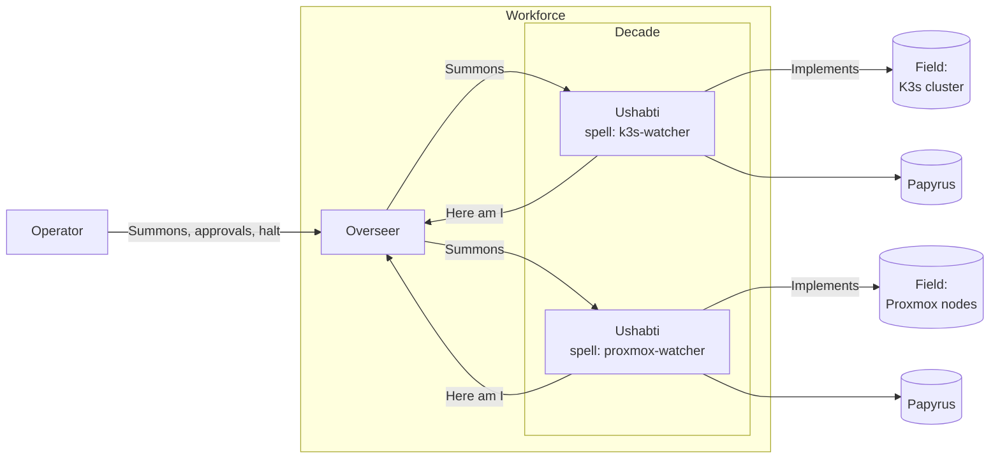
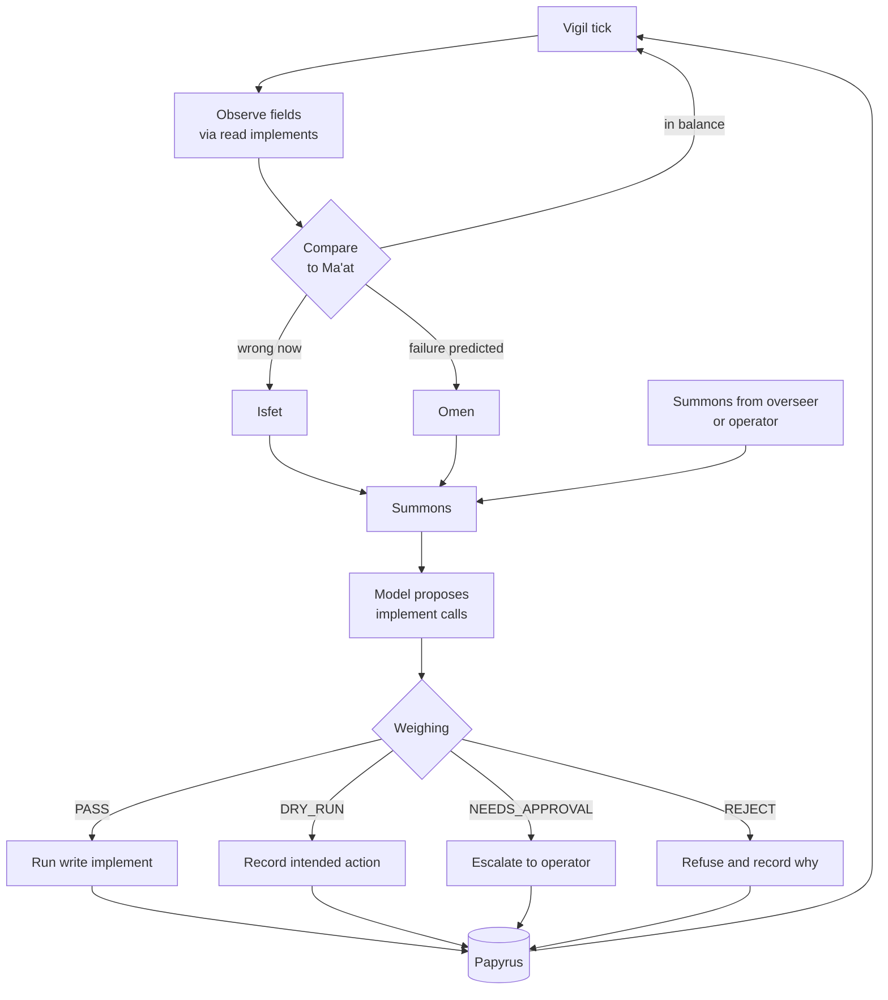

# Architecture

Ushabti monitors infrastructure, detects current failures, predicts upcoming
ones, and takes guarded corrective actions. This page explains how the pieces
fit together and walks through each step of the loop. The terms come from the
[glossary](glossary.md). The central one: an ushabti is one agent instance.

## The pieces

The repository holds three Python packages.

| Package | Role |
|---|---|
| `ushabti` | The SDK. It defines the spell (the declarative definition of one ushabti), implements (the tools an ushabti can use), the weighing (the safety gate every write implement must pass), Papyrus (the append-only audit log), and the model providers. |
| `ushabti-agent` | The runtime of one ushabti running one spell: the loop below, a command line, and an HTTP API. |
| `ushabti-overseer` | The overseer (the optional orchestrator). It registers ushabti, routes work to them, and tracks their health. |

The SDK has no network server and no command line. The other two packages
depend on it and never on each other: an ushabti and an overseer only meet over
HTTP.

## Three modes

A decade is a group of ushabti supervised by one overseer. The default size is
10. The workforce is everything deployed: all overseers and ushabti.

| Mode | Meaning |
|---|---|
| `solo` | One ushabti running one spell; no overseer. |
| `independent` | Several ushabti, each configured and deployed separately; no overseer. |
| `overseen` | One or more overseers coordinate decades of ushabti. |

## Deployed topology in overseen mode

Reading the diagram:

- **Here am I.** Each ushabti posts a "Here am I" message (the health signal
  and acknowledgement) to the overseer when it starts and at a steady interval
  after that. The first one registers it. The message carries the names of the
  fields (the targets it tends) and implements its spell covers, so the overseer
  can route work without holding the spell. An ushabti that misses more than three expected
  messages is marked `lost`.
- **Summons.** A summons is a unit of work. An operator posts one to the
  overseer, which routes it to an ushabti whose spell covers the field and the
  implement the summons names. Among those that qualify, the
  one routed to least recently goes first. If none can take it, the overseer
  answers `409` with the reason.
- **Implements.** Only an ushabti touches a field. The overseer never does.
- **Papyrus.** Each ushabti writes its own audit log. The overseer keeps its
  registry in memory and writes none.
- **Halt.** An operator can halt (the kill switch) one ushabti directly, or post
  a halt to the overseer, which fans it out to the whole workforce and reports
  an error if it misses anyone.

In `solo` and `independent` modes there is no overseer. The operator talks to
each ushabti directly, and everything below is unchanged.

## The loop inside one ushabti

Each step, in order:

1. **Vigil tick.** The vigil is the monitoring loop. It ticks at the interval
   the spell sets under `vigil.interval`, 60 seconds by default. Each tick is
   recorded.

2. **Observe fields via read implements.** Ma'at is the desired state: a list
   of assertions about what healthy looks like. Every assertion that has an
   `observe` block names a read implement and its arguments. The vigil runs
   it and records what came back. If the implement fails, the failure is
   recorded and that assertion is unknown for this tick. The vigil cannot run a
   write implement here: the guard inside every implement refuses.

3. **Compare to Ma'at.** For each observation the vigil looks up the path
   named in the assertion's `expect` and applies the comparison. No model is involved, so a tick
   costs nothing.

4. **In balance.** When `expect` holds and no warning is met, nothing is
   raised. If the assertion was drifting on the previous tick, the return to
   balance is recorded.

5. **Isfet.** Isfet is current drift from Ma'at: something is wrong now. It is
   raised when `expect` does not hold.

6. **Omen.** An omen is a prediction that Ma'at will be broken soon. It is
   raised when `expect` still holds but the `omen` condition is also met, for
   example a disk at 85 percent when the limit is 90.

7. **Summons.** Isfet and omens each raise one summons when they first appear,
   not one per tick, so standing drift does not call the model every minute. A
   summons can also arrive from an overseer or an operator through
   `POST /summons`. Either way it is queued and answered in order.

8. **Model proposes implement calls.** The ushabti sends the model its role,
   its instructions, its Ma'at, the summons, and the implements its spell
   lists. The model replies with implement calls. The ushabti returns each
   result and asks again, up to `model.max_steps` times, until the model
   proposes nothing more.

9. **Weighing.** Every proposed call is weighed before anything happens. The
   default weighing applies seven rules in order and the first match decides.
   They are listed in [safety.md](safety.md). The verdict is written to
   Papyrus before the call runs, so the log never trails an action.

10. **PASS: run the implement.** The implement runs, and its result or its
    failure is recorded. A write implement checks the verdict itself and
    refuses to run without a `PASS` that names it.

11. **DRY_RUN: record the intended action.** The call is recorded and not run.
    This is the outcome for every write while the spell has `dry_run: true`.

12. **NEEDS_APPROVAL: escalate to the operator.** The call is recorded and not
    run, and the summons ends in the state `escalated`, which the API exposes
    at `GET /summons/{id}`. Acting on an approval is outside this scaffold.

13. **REJECT: refuse and record why.** The call is recorded with the rule that
    rejected it and the reason, and is not run.

14. **Papyrus.** Every step above is one line in the audit log: the tick, each
    observation, isfet, omens, each summons as it is queued and as it ends,
    each proposal, each verdict, each action, and each halt and resume.

15. **Back to the vigil.** The loop waits for the next tick or the next
    summons, whichever comes first.

## Halt

A halted ushabti stops acting but keeps observing. It still ticks, observes,
and records isfet and omens. It raises no summons and calls no model, and the
first rule of the weighing rejects anything already in flight. Halting needs no
model call.

Halt state is not a separate flag. It is the last `halt` or `resume` line in
Papyrus, replayed when the ushabti starts. A restart therefore cannot undo a
halt, as long as Papyrus is on storage that outlives the process.

## The HTTP APIs

One ushabti, on port 8080 by default:

| Method and path | Behaviour |
|---|---|
| `GET /healthz` | Returns its "Here am I" body: name, spell, mode, halted flag, last vigil time. |
| `GET /metrics` | Prometheus metrics: vigil ticks, isfet count, omen count, verdicts by type, actions run. |
| `POST /summons` | Accepts a summons and returns `202` with its id. Needs the token. |
| `GET /summons/{id}` | Returns the summons in its current state. Needs the token. |
| `POST /halt`, `POST /resume` | Halt and resume. Need the token. |

The overseer, on port 8081 by default:

| Method and path | Behaviour |
|---|---|
| `GET /healthz` | Whether the overseer is up, and how many ushabti are lost. |
| `POST /here-am-i` | Registers an ushabti or notes that it answered again. Needs the token. |
| `GET /workforce` | Lists every ushabti with its decade, spell, status, and last "Here am I". Needs the token. |
| `POST /summons` | Routes the summons, or returns `409` with a reason. Needs the token. |
| `POST /halt` | Fans out halt to the whole workforce. Needs the token. |

"The token" is the bearer token in `USHABTI_ADMIN_TOKEN`. When it is unset,
every endpoint that needs it is disabled. Registration is guarded because the
overseer later sends the token to the URL an ushabti registered.

## Model providers

A model provider turns a conversation into a reply that may contain implement
calls. Three ship with the SDK:

| Provider | Use |
|---|---|
| `anthropic` | Anthropic models through the Anthropic SDK. Needs the `anthropic` extra. |
| `openai_compatible` | Any endpoint that speaks the OpenAI Chat Completions API, including local servers. Needs the `openai` extra. |
| `fake` | Replays a script. Deterministic, with no network, for tests and demos. |

The provider SDKs are imported only when a provider is built, so the core
installs and runs without them.

## What is not built yet

- The `kubernetes.*`, `proxmox.*`, and `prometheus.*` implements are stubs.
- The overseer's registry is in memory and is empty after a restart.
- There is one overseer. Coordination between several, and leader election,
  are not built.
- An escalated call is recorded and exposed, and nothing more. There is no
  approval workflow.
